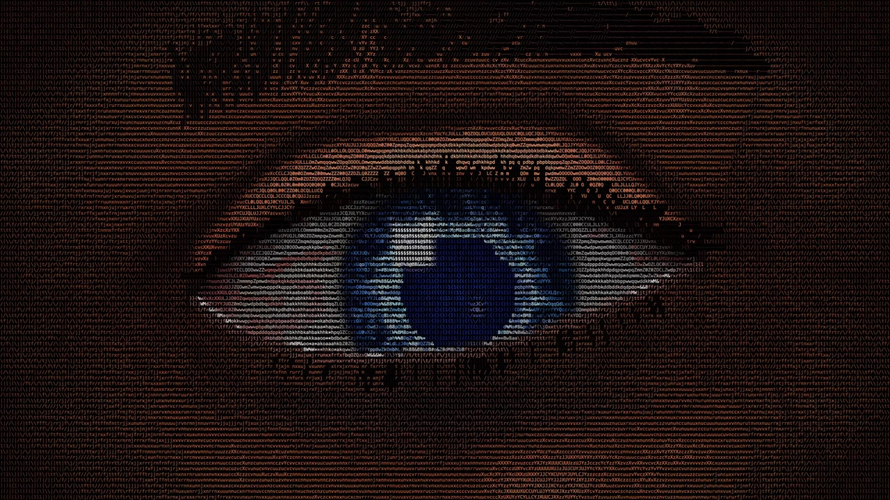
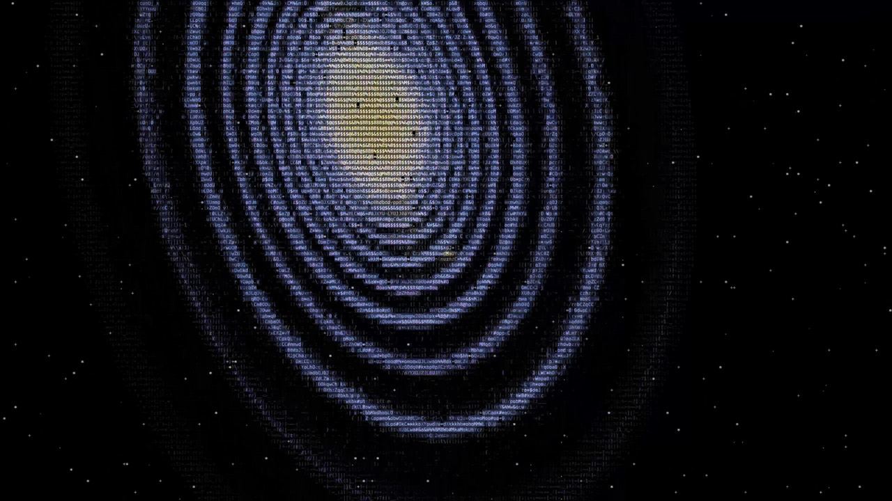
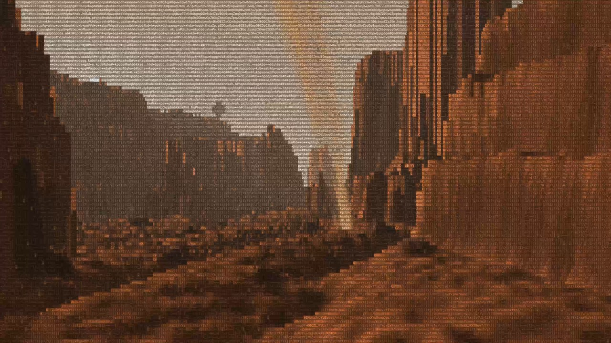

<div align="center">

# GALAXY

**A 9-minute journey through the universe, drawn entirely with text characters.**

Live in your terminal, with no images and no video.


</div>

It starts with an eye looking back at you. It blinks, it hesitates, it lives. Then the Milky Way forms deep inside its pupil, you dive in, and the journey begins.

No narration. Just you, your terminal and the universe.

## The journey

<table>
  <tr>
    <td width="50%"><br><sub><b>The eye</b>, where everything begins and returns</sub></td>
    <td width="50%"><br><sub><b>The cosmos</b>, from a black hole to a supernova and the Big Bang</sub></td>
  </tr>
  <tr>
    <td width="50%"><br><sub><b>Mars</b>, among ruins and dust</sub></td>
    <td width="50%"><br><sub><b>Earth</b>, a trip around the world</sub></td>
  </tr>
</table>

## Run it

All you need is [Node.js](https://nodejs.org). There is nothing else to install.

```sh
git clone https://github.com/Seijurio/galaxysame.git
cd galaxysame
node eye.js
```

| Key | Action |
| --- | --- |
| `q` | Quit |
| `fin` | Skip to the end of the journey, or skip the credits |

The journey lasts about 9 minutes with credits, then starts again.

## Full screen

In macOS Terminal, the journey switches to full screen by itself, with a smaller font on a black background. Everything goes back to normal when you quit.

The first time, macOS may ask for permission to control Terminal: accept it. For true full screen with no title bar, also allow Terminal in System Settings > Privacy & Security > Accessibility. Without that, the window is simply maximized.

In other terminals, maximize the window and reduce the font size yourself: the smaller the characters, the more detailed the picture. You need a terminal with 24-bit color support.

## How it works

Every frame is computed live, then translated into characters and colors.

- **One file:** `eye.js`, plain JavaScript on Node.js, with zero dependencies.
- **Real physics:** general relativity for the black hole, Runge-Kutta orbits, simulated gravity for the galaxy collision.
- **Generated worlds:** fractal noise, ray casting and Fresnel reflections for planets, oceans and cities.

## License

[MIT](LICENSE)
