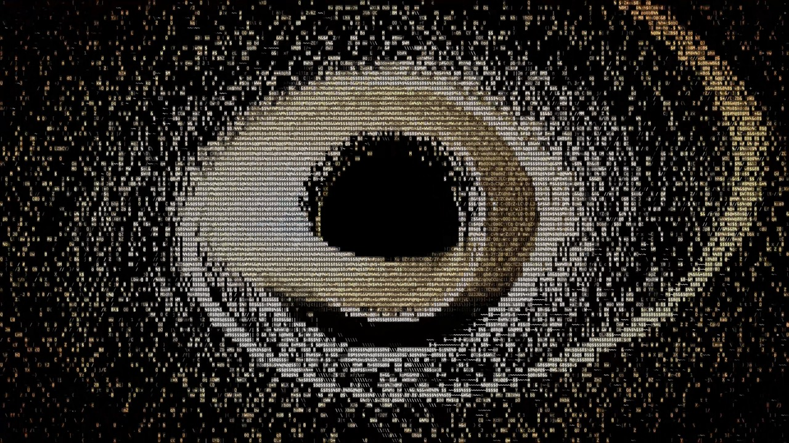
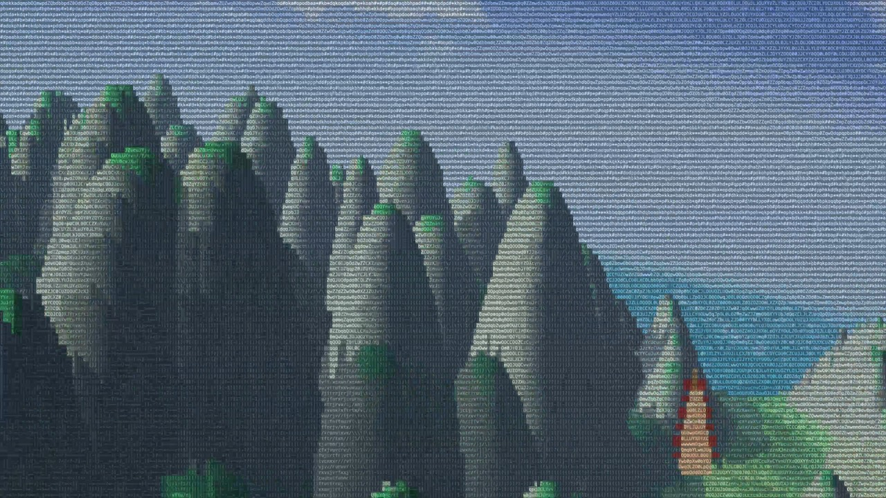

<div align="center">

# GALAXY

**Un voyage de 9 minutes à travers l'univers, dessiné uniquement avec des lettres.**

Dans votre terminal, en direct, sans image ni vidéo.




</div>

Tout commence par un œil qui vous regarde. Il cligne, il hésite, il vit. Puis la Voie lactée se forme au fond de sa pupille, on plonge dedans, et le voyage commence.

Pas de texte, pas de narration. Juste vous, votre terminal et l'univers.

## Le voyage

<table>
  <tr>
    <td width="50%"><br><sub><b>L'œil</b>, où tout commence et où tout revient</sub></td>
    <td width="50%"><br><sub><b>Le cosmos</b>, du trou noir à la supernova et au Big Bang</sub></td>
  </tr>
  <tr>
    <td width="50%"><br><sub><b>Mars</b>, entre les ruines et la poussière</sub></td>
    <td width="50%"><br><sub><b>La Terre</b>, un tour du monde de ville en ville</sub></td>
  </tr>
</table>

## Lancer le voyage

Il vous faut seulement [Node.js](https://nodejs.org), rien d'autre à installer.

```sh
git clone https://github.com/Seijurio/galaxysame.git
cd galaxysame
node eye.js
```

| Touche | Effet |
| --- | --- |
| `q` | Quitter |
| `fin` | Filer vers la fin du voyage, ou passer le générique |

Le voyage dure environ 9 minutes, générique compris, puis recommence.

## Plein écran

Sur le Terminal de macOS, le voyage passe tout seul en plein écran avec une police plus fine, sur fond noir. Tout revient comme avant quand vous quittez.

La première fois, macOS peut demander une autorisation pour contrôler le Terminal : acceptez-la. Pour le vrai plein écran, sans barre de titre, autorisez aussi le Terminal dans Réglages Système > Confidentialité et sécurité > Accessibilité. Sans ça, la fenêtre est simplement agrandie.

Sur les autres terminaux, mettez la fenêtre en grand et réduisez la police vous-même : plus les caractères sont petits, plus l'image est détaillée. Il faut un terminal qui gère les couleurs 24 bits.

## Comment ça marche

Chaque image est calculée en direct, puis traduite en caractères et en couleurs.

- **Un seul moteur** : JavaScript et Node.js, sans aucune dépendance.
- **De la vraie physique** : relativité générale pour le trou noir, orbites par Runge-Kutta, gravité simulée pour la collision des galaxies.
- **Des mondes générés** : bruit fractal, lancer de rayons et reflets de Fresnel pour les planètes, les océans et les villes.

## Enregistrer le film en vidéo

Sur Mac, avec les outils de ligne de commande Xcode :

```sh
node record/record.js
```

Le film sort en 4K dans `episode1-4k.mp4`, avec une musique originale composée par le code et calée sur l'image.

| Option | Effet |
| --- | --- |
| `--size 900` | Taille visée en Mo |
| `--music morceau.mp3` | Utiliser une autre musique |
| `--hevc` | Meilleure qualité à poids égal |
| `--from 100 --to 130` | N'enregistrer qu'un extrait |

## Licence

[MIT](LICENSE)
